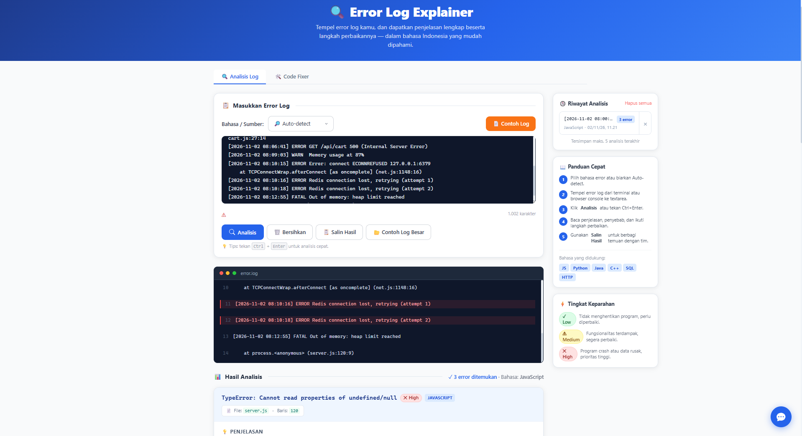
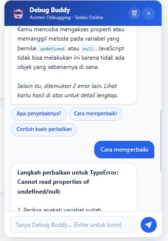

# Error Log Explainer & Debug Buddy

Aplikasi web yang membantu developer, terutama pemula, memahami error log dan memperbaikinya lebih cepat. Dibangun dengan **IBM Bob (mode Agent)** menggunakan HTML, Tailwind CSS, dan Vanilla JavaScript, tanpa framework dan tanpa API eksternal.

Capstone Project: Hacktiv8 x IBM SkillsBuild, Track IT (AI Agent for Programming).

**Demo:** https://nekoharin.github.io/Error-Log-Explainer-Debug-Buddy/

## Masalah yang Diselesaikan

Pesan error dan stack trace sering sulit dipahami: panjang, berbahasa Inggris, dan formatnya berbeda di tiap bahasa pemrograman. Aplikasi ini menerjemahkannya menjadi penjelasan berbahasa Indonesia, penyebab, dan langkah perbaikan.

## Fitur

- **Analisis error log**: tempel log, lalu dapatkan nama error, tingkat keparahan (Low/Medium/High), penjelasan, kemungkinan penyebab, langkah perbaikan, dan contoh kode.
- **Dukungan bahasa**: JavaScript, Python, Java, C++, SQL, dan HTTP/Network, plus Auto-detect.
- **Multi-error**: beberapa error dalam satu log dianalisis berurutan, lengkap dengan nama file dan nomor baris. 
- **Analisis log besar**: pengelompokan error berulang, filter level (INFO/WARN/ERROR/FATAL), pencarian, dan timeline berdasarkan timestamp. 
- **Debug Buddy (chatbot)**: tanya jawab lanjutan tentang hasil analisis terakhir, berbasis aturan. 
- **Code Context Fixer**: menyorot baris bermasalah dan memberi saran perbaikan berbasis aturan dalam tampilan diff. 
- **Riwayat analisis** tersimpan di `localStorage`, tombol salin hasil, dan contoh log siap pakai.
- Input di-escape agar aman dari XSS, tampilan responsif (mobile-first), dan aksesibilitas dasar.

## Cara Kerja

Aplikasi ini bersifat **rule-based**. Log dicocokkan dengan kumpulan pola (regex) di `rules.js`. Jika ada yang cocok, penjelasan dan langkah perbaikan ditampilkan. Jika tidak, aplikasi menampilkan pesan "Error belum dikenali" beserta saran debugging umum. Debug Buddy dan Code Fixer memakai aturan dan data yang sama, bukan model bahasa (LLM).

## Teknologi

- HTML5 (semantik)
- Tailwind CSS (via CDN) dan `style.css` untuk styling tambahan
- Vanilla JavaScript
- IBM Bob sebagai AI coding assistant

## Struktur Folder

```
.
├── index.html      # Struktur halaman
├── style.css       # Styling tambahan
├── script.js       # Logika utama aplikasi
├── rules.js        # Kumpulan aturan error
├── chatbot.js      # Debug Buddy         
├── logParser.js    # Analisis log besar  
├── codeFixer.js    # Code Context Fixer  
└── README.md
```

## Cara Menjalankan

1. Clone repo ini:
   ```bash
   git clone https://github.com/NekohaRin/Error-Log-Explainer-Debug-Buddy.git
2. Buka foldernya di VS Code atau IBM Bob.
3. Pasang ekstensi **Live Server**, klik kanan `index.html`, lalu pilih **Open with Live Server**.

Atau cukup buka `index.html` langsung di browser. Koneksi internet dibutuhkan karena Tailwind dimuat dari CDN.

## Contoh Penggunaan

1. Pilih bahasa (atau biarkan Auto-detect).
2. Klik **Contoh Log** atau tempel log milikmu.
3. Klik **Analisis** untuk melihat hasilnya.
4. Buka **Debug Buddy** dan tanyakan misalnya: `jelaskan error ini` atau `kasih contoh kodenya`.

Contoh log:

```
[2026-11-02 08:00:01] INFO  Server started on port 3000
[2026-11-02 08:00:02] INFO  Connected to database
[2026-11-02 08:03:11] WARN  Slow query detected (2300ms): SELECT * FROM orders WHERE user_id = 101
[2026-11-02 08:05:27] ERROR TypeError: Cannot read properties of undefined (reading 'price') at cart.js:27:14
[2026-11-02 08:05:29] ERROR GET /api/cart 500 (Internal Server Error)
[2026-11-02 08:06:40] ERROR TypeError: Cannot read properties of undefined (reading 'price') at cart.js:27:14
[2026-11-02 08:06:41] ERROR GET /api/cart 500 (Internal Server Error)
[2026-11-02 08:09:03] WARN  Memory usage at 87%
[2026-11-02 08:10:15] ERROR Error: connect ECONNREFUSED 127.0.0.1:6379
    at TCPConnectWrap.afterConnect [as oncomplete] (net.js:1148:16)
[2026-11-02 08:10:16] ERROR Redis connection lost, retrying (attempt 1)
[2026-11-02 08:10:18] ERROR Redis connection lost, retrying (attempt 2)
[2026-11-02 08:12:55] FATAL Out of memory: heap limit reached
    at process.<anonymous> (server.js:120:9)
```

## Screenshot

<!-- Taruh gambar di folder screenshots/ lalu ganti nama file di bawah -->



## Proses Pengembangan (Prompt Engineering)

Prompt disusun dalam 3 layer:

1. **Role & Context**: Senior Frontend Engineer, nama project, dan batasan teknologi.
2. **Task & Requirements**: daftar fitur konkret yang harus dibangun.
3. **Constraints & Output**: struktur file, tema visual, aksesibilitas, keamanan, dan kualitas kode.

Pengembangan dilakukan secara iteratif dengan prinsip *targeted refinement* (satu masalah direvisi pada satu layer saja): aplikasi dasar, dukungan C++, chatbot Debug Buddy, analisis log besar, lalu Code Context Fixer.

## Keterbatasan

- Berbasis aturan, sehingga hanya mengenali error yang ada di `rules.js`.
- Saran perbaikan di Code Fixer hanya tersedia untuk pola error tertentu.
- Aplikasi tidak pernah menjalankan (eval) kode yang ditempel pengguna.

## Pengembangan Lanjutan

- Integrasi LLM lewat backend agar penjelasan lebih fleksibel.
- Penambahan bahasa dan framework (Go, Rust, PHP, TypeScript, React, Spring, Django).
- Custom rule editor dan dashboard statistik.
- Ekstensi VS Code/CLI dan pemantauan log real-time.
- Unit test untuk setiap aturan error.

## Catatan

Dibuat untuk keperluan pembelajaran dalam program Hacktiv8 x IBM SkillsBuild.